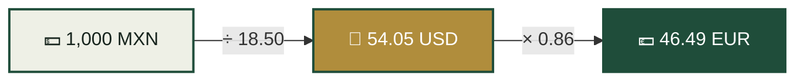
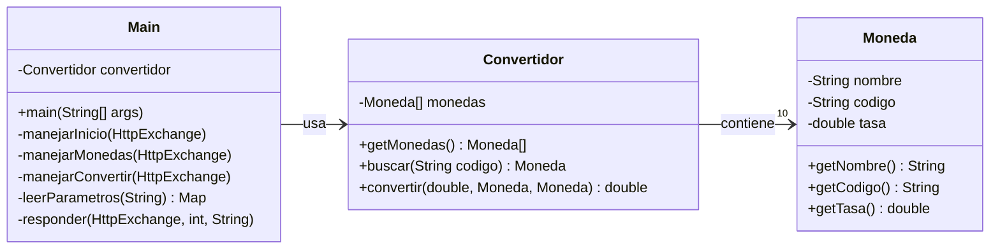
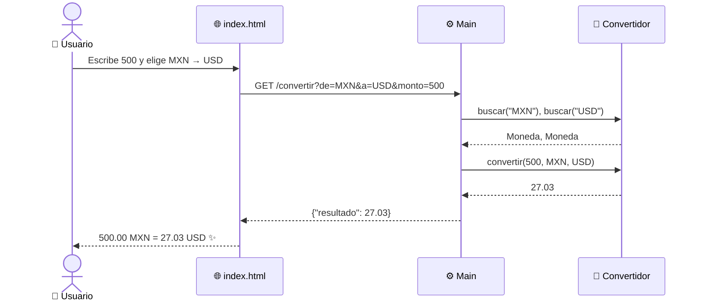

<div align="center">

```
███╗   ███╗ ██████╗ ███╗   ██╗███████╗██████╗  █████╗ ███████╗
████╗ ████║██╔═══██╗████╗  ██║██╔════╝██╔══██╗██╔══██╗██╔════╝
██╔████╔██║██║   ██║██╔██╗ ██║█████╗  ██║  ██║███████║███████╗
██║╚██╔╝██║██║   ██║██║╚██╗██║██╔══╝  ██║  ██║██╔══██║╚════██║
██║ ╚═╝ ██║╚██████╔╝██║ ╚████║███████╗██████╔╝██║  ██║███████║
╚═╝     ╚═╝ ╚═════╝ ╚═╝  ╚═══╝╚══════╝╚═════╝ ╚═╝  ╚═╝╚══════╝
```

# 💱 API de Conversión de Monedas

### *10 monedas. 90 combinaciones. 1 sola fórmula. 0 dependencias.*

**Una API REST hecha en Java puro, sin frameworks y sin librerías externas.**
Solo `HttpServer`, programación orientada a objetos y mucho café ☕.

<br>


<br>

[⚡ Inicio rápido](#-inicio-rápido) •
[🛣️ Endpoints](#️-endpoints) •
[🧠 Cómo funciona](#-cómo-funciona) •
[🏗️ Arquitectura](#️-arquitectura) •
[👥 Equipo](#-el-equipo)

</div>

---

## 📸 Vista previa

<div align="center">

<!-- 👇 Guarda tu captura en la carpeta docs/ con este nombre -->


*Escribes el monto, eliges las monedas y listo: el resultado aparece al instante, sin recargar la página.*

</div>

---

## ✨ ¿Qué lo hace especial?

<table>
<tr>
<td width="50%" valign="top">

### 🪶 Cero dependencias
No usa Maven, Gradle, Spring ni librerías externas. Todo corre con lo que ya trae Java. Lo clonas, le das **Run** y ya funciona.

</td>
<td width="50%" valign="top">

### 🧮 Una sola fórmula
No hay 90 `if` ni un `switch` gigante. Todas las conversiones pasan por el dólar como moneda base, así que cualquier par funciona con **un solo método**.

</td>
</tr>
<tr>
<td width="50%" valign="top">

### 🛡️ A prueba de errores
Monedas que no existen, montos negativos, texto en lugar de números, rutas inventadas: todo regresa un error claro con su código HTTP. **Nada truena.**

</td>
<td width="50%" valign="top">

### 🎨 Interfaz incluida
Una página web con diseño inspirado en billetes, botón para invertir las monedas ⇄ y soporte para la tecla Enter. **La API y su frontend en el mismo servidor.**

</td>
</tr>
</table>

---

## ⚡ Inicio rápido

> **Requisito:** Java 11 o superior. Nosotros lo desarrollamos con **Java 25 (Eclipse Temurin)**.

```bash
# 1. Clona el repositorio
git clone https://github.com/gumis0725-crypto/api-monedas.git
cd api-monedas

# 2. Compila
javac *.java

# 3. Arranca el servidor 🚀
java Main
```

Si todo salió bien, vas a ver:

```
Servidor corriendo en http://localhost:8080
Presiona Ctrl + C para detenerlo
```

Abre **[http://localhost:8080](http://localhost:8080)** en tu navegador y listo. 🎉

<details>
<summary><b>💻 ¿Usas VS Code?</b></summary>
<br>

1. Instala la extensión **Extension Pack for Java** (de Microsoft).
2. Abre la carpeta del proyecto.
3. Abre `Main.java` y dale clic a **Run**, arriba del método `main`.

</details>

---

## 🛣️ Endpoints

| Método | Ruta | Descripción |
|:---:|---|---|
|  | `/` | Muestra la página web del convertidor |
|  | `/monedas` | Lista de las 10 monedas disponibles |
|  | `/convertir?de=&a=&monto=` | Convierte un monto entre dos monedas |

### 📋 `GET /monedas`

```http
GET http://localhost:8080/monedas
```

```json
[
  { "codigo": "MXN", "nombre": "Peso mexicano" },
  { "codigo": "USD", "nombre": "Dolar" },
  { "codigo": "EUR", "nombre": "Euro" },
  "..."
]
```

### 🔄 `GET /convertir`

| Parámetro | Tipo | Descripción | Ejemplo |
|---|---|---|---|
| `de` | `String` | Código de la moneda de origen | `MXN` |
| `a` | `String` | Código de la moneda de destino | `USD` |
| `monto` | `double` | Cantidad a convertir (≥ 0) | `500` |

```http
GET http://localhost:8080/convertir?de=MXN&a=USD&monto=500
```

```json
{
  "de": "MXN",
  "a": "USD",
  "monto": 500.00,
  "resultado": 27.03
}
```

> 💡 No importa si escribes los códigos en mayúsculas o minúsculas: `mxn` y `MXN` funcionan igual.

---

## 🌎 Monedas disponibles

<div align="center">

| | Moneda | Código | 1 USD = |
|:---:|---|:---:|---:|
| 🇲🇽 | Peso mexicano | `MXN` | 18.50 |
| 🇺🇸 | Dólar estadounidense | `USD` | 1.00 |
| 🇪🇺 | Euro | `EUR` | 0.86 |
| 🇬🇧 | Libra esterlina | `GBP` | 0.74 |
| 🇯🇵 | Yen japonés | `JPY` | 147.00 |
| 🇨🇦 | Dólar canadiense | `CAD` | 1.38 |
| 🇨🇴 | Peso colombiano | `COP` | 4,000.00 |
| 🇦🇷 | Peso argentino | `ARS` | 1,300.00 |
| 🇧🇷 | Real brasileño | `BRL` | 5.40 |
| 🇨🇳 | Yuan chino | `CNY` | 7.15 |

<sub>⚠️ Tasas aproximadas con fines educativos. No las uses para tus inversiones 😅</sub>

</div>

---

## 🧠 Cómo funciona

El truco para no escribir 90 fórmulas distintas es usar el **dólar como puente**:

<div align="center">

### `resultado = monto ÷ tasaOrigen × tasaDestino`

</div>



Con 10 tasas cubrimos las **90 combinaciones posibles**. Si queremos agregar una moneda más, solo añadimos una línea al arreglo. 🪄

---

## 🏗️ Arquitectura

Cada clase tiene **una sola responsabilidad**:



### 🔁 Flujo de una petición



### 📁 Estructura

```
api-monedas/
├── 📄 Moneda.java         → Modelo: nombre, código y tasa
├── 🧮 Convertidor.java    → Lógica: búsqueda y conversión
├── ⚙️ Main.java           → Servidor HTTP y rutas
├── 🌐 index.html          → Interfaz web
├── 📁 docs/
│   └── 🖼️ captura.png     → Vista previa
└── 📖 README.md           → Estás aquí 👋
```

---

## 🛡️ Manejo de errores

La API nunca se cae. Siempre responde con un error claro:

| Código | Situación | Respuesta |
|:---:|---|---|
|  | La moneda no existe (`de=XYZ`) | `{"error": "Moneda no valida..."}` |
|  | Falta el monto o no es un número | `{"error": "El monto falta o no es un numero"}` |
|  | El monto es negativo | `{"error": "El monto no puede ser negativo"}` |
|  | La ruta no existe | `{"error": "Ruta no encontrada"}` |
|  | El método no es `GET` | `{"error": "Metodo no permitido"}` |

---

## 🗺️ Roadmap

- [x] Convertidor en consola con menú de 10 monedas
- [x] API REST con `HttpServer`
- [x] Manejo de errores con códigos HTTP
- [x] Interfaz web conectada a la API
- [ ] Tasas en tiempo real desde un servicio externo
- [ ] Historial de conversiones
- [ ] Gráfica de la variación de cada moneda

---

## 🐛 Problemas conocidos (y cómo los resolvimos)

<details>
<summary><b>❌ <code>class X is public, should be declared in a file named X.java</code></b></summary>
<br>

En Java, la clase `public` debe llamarse **exactamente igual** que el archivo. Si el archivo es `Main.java`, la clase debe ser `public class Main`.

</details>

<details>
<summary><b>❌ <code>java -version</code> dice 1.8 pero <code>javac -version</code> dice 25</b></summary>
<br>

Tienes dos Java instalados y Windows está encontrando primero el viejo. Revísalo con:

```bash
where java
```

Desinstala **Java 8** desde *Configuración → Aplicaciones* y deja solo el JDK moderno.

</details>

<details>
<summary><b>❌ <code>Address already in use</code></b></summary>
<br>

Ya hay otro servidor usando el puerto 8080, probablemente el que dejaste corriendo antes. Detenlo con **Ctrl + C** y vuelve a correr `Main`.

</details>

---

## 👥 El equipo

<div align="center">

| | | |
|:---:|:---:|:---:|
| 👨‍💻 | 👨‍💻 | 👨‍💻 |
| **José Eliel Martínez Estrada** | **Patricio Hernández Baños** | **Gustavo Leonel Gálvez Hernández** |

<br>

🎓 **Licenciatura en Inteligencia Artificial**
**Centro Universitario Metropolitano de Hidalgo (CEUMH)**

📚 Programación Orientada a Objetos 2
👩‍🏫 Lic. María Cristina Martínez Cruz

</div>

---

<div align="center">

### ⭐ Si este proyecto te sirvió o te gustó, déjale una estrella ⭐

<br>

**Hecho con ☕, Java y muchas horas de debugging.**

<sub>© 2026 · Proyecto académico · CEUMH</sub>

</div>
